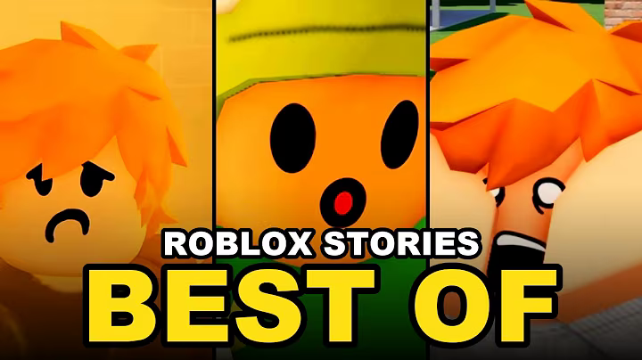
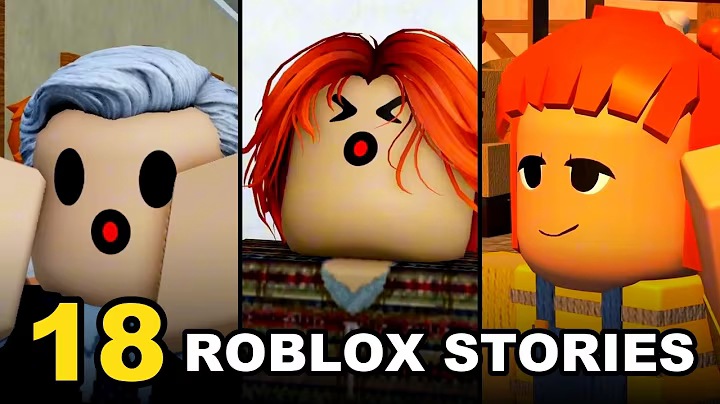

<div align="center">

```text
  _____  _   _  ___  ____       _____   ___   _    _  _   _ 
 |_   _|| | | ||_ _|/ ___|     |_   _| / _ \ | |  | || \ | |
   | |  | |_| | | | \___ \       | |  | | | || |  | ||  \| |
   | |  |  _  | | |  ___) |      | |  | |_| || |/\| || |\  |
   |_|  |_| |_||___||____/       |_|   \___/ |__/\__||_| \_|
```

<span style="color:pink">IN THIS TOWN, WE CREATE TOWNS</span>

# IN THIS TOWN SKILL V 1.0

### One idea in. A finished vertical Roblox-style story short out.

**No Roblox Studio. No Blender. No code. No API keys. No paid plan.**

[](https://github.com/hackerlolord/in-this-town-skill/releases)
[](#)
[](#install-in-60-seconds)
[](#)
[](https://github.com/hackerlolord/in-this-town-skill/stargazers)

**[⬇ DOWNLOAD THE SKILL — `IN THIS TOWN SKILL V 1.0.zip`](https://github.com/hackerlolord/in-this-town-skill/raw/main/IN%20THIS%20TOWN%20SKILL%20V%201.0.zip)**

</div>

---

## 🎬 WATCH IT MAKE A VIDEO

<div align="center">

<video src="https://raw.githubusercontent.com/hackerlolord/in-this-town-skill/main/assets/demo.mp4" poster="https://raw.githubusercontent.com/hackerlolord/in-this-town-skill/main/assets/result-3.png" controls width="100%"></video>

**[▶ Open the full demo video](assets/demo.mp4)** — 15.9 s · 2992 × 1440 · 60 fps

</div>

---

## 🖼 MADE WITH THE SKILL

Three real outputs. Different rules, different worlds, different characters — never the same town twice.

<table>
  <tr>
    <td width="33.3%" valign="top"><a href="assets/result-1.png"></a></td>
    <td width="33.3%" valign="top"><a href="assets/result-2.png"></a></td>
    <td width="33.3%" valign="top"><a href="assets/result-3.png"></a></td>
  </tr>
  <tr>
    <td align="center"><sub>Story world #1</sub></td>
    <td align="center"><sub>Story world #2</sub></td>
    <td align="center"><sub>Story world #3</sub></td>
  </tr>
</table>

---

## ✨ WHAT IS IN THIS TOWN SKILL V 1.0?

A complete, self-contained AI-agent skill that turns a story idea into a polished **9:16 shorts video** with blocky, game-world characters.

You make the choices. The agent does everything else:

- writes six fresh story ideas, then a full script to your chosen length
- builds the world in code with three.js — suburbs, meadows, plazas, city streets, rooms, or one of ~55 free themed kits
- creates a cast of block avatars with pixel faces that **lip-sync to the narration**
- adds walking NPCs, driving cars, magic, jumps, falls, crashes and camera moves
- draws word-by-word captions in the viral short style
- generates or imports the voice, then layers music and timed sound effects
- checks still frames for framing and collision problems before rendering
- renders the final MP4 and lets you ask for changes

Everything lives in the ZIP. No marketplace hunting, no extra skills, no built-in computer voices.

> **IN THIS TOWN SKILL V 1.0** is the exact name of the skill and of the ZIP folder inside the download. Use it everywhere.

---

## 🧭 THE 7-STEP FLOW

| # | Step | What you get | Do you decide? |
|:-:|---|---|:-:|
| 1 | **Set up** | Node, three.js, browser and ffmpeg installed for you | no |
| 2 | **Story ideas** | 6 ideas + your top 3 + "your own story" | **yes** |
| 3 | **Script** | Every line, with title and word count | **yes** |
| 4 | **Voice** | Kokoro TTS, Google AI Studio, or your own audio | **yes** |
| 5 | **Plan** | Cast, places, effects and moods | no |
| 6 | **Build & check** | A sheet of stills to approve | **yes** |
| 7 | **Render** | `out/video.mp4` — then ask for any change | **yes** |

The script is always approved **before** any voice work starts. Your own script is never rewritten without your permission. Every video gets a new rule, new names, new cast, new place and a new seed — repetition is refused by design.

---

## 📦 WHAT'S IN THE ZIP

```
IN THIS TOWN SKILL V 1.0/
├── SKILL.md              the complete agent instructions
├── script.md             the five story shapes
├── examples.md           finished example scripts
├── look.md               pacing, shots, acting, captions, sound
├── api.md                characters, worlds, kits, effects, checks
└── template/             the full working renderer
    ├── setup.mjs         one-click setup
    ├── voice.mjs         voice import + timing
    ├── render.mjs        stills, checks and final video
    ├── pf.mjs            free 3D kits and models
    ├── lib/blocky/       the blocky 3D engine
    ├── scenes/           example scenes and game layer
    ├── audio/            music, SFX planner and sound kit
    ├── fonts/            Montserrat
    ├── textures/         ground, sky and tree textures
    └── install/          Node installers for Mac/Windows/Linux
```

---

## ⚡ INSTALL IN 60 SECONDS

**Use any free AI agent you like.** Download one of these, upload the ZIP **directly** into it, and tell the agent to install and run the skill.

### 1️⃣ Download a free agent

| Agent | Direct Windows download | All platforms / notes |
|---|---|---|
| **OpenCode** | [opencode-desktop-win-x64.exe](https://opencode.ai/update/api/latest/desktop/opencode/opencode-desktop-win-x64.exe) | [All downloads](https://opencode.ai/download) · desktop, terminal, mobile |
| **Antigravity** | [Antigravity-x64.exe](https://storage.googleapis.com/antigravity-public/antigravity-hub/2.35.2-4585983447007232/windows-x64/Antigravity-x64.exe) | [Download page](https://antigravity.google/download) · IDE, CLI, extensions |
| **Kilo AI (Kilo Code)** | [VS Code](https://code.visualstudio.com/download) → Extensions → **Kilo Code** (pre-release) | [Install guide](https://kilo.ai/docs/getting-started/installing) · [VSIX releases](https://github.com/Kilo-Org/kilocode/releases/latest) |
| **Free Buff** | [Windows 64-bit installer](https://freebuff.com/api/desktop/download/windows) | [freebuff.com](https://freebuff.com/) · 100% free coding agent |
| **Deep AI Code** | [windows-x64 installer](https://deepai.org/download/deepai-code/windows-x64) | [deepai.org/chat/ai-code](https://www.deepai.org/chat/ai-code) · Mac, Windows, Linux |

All five links are first-party. Pick one — you do not need all of them.

### 2️⃣ Upload the ZIP — **do not extract it**

Download **[`IN THIS TOWN SKILL V 1.0.zip`](https://github.com/hackerlolord/in-this-town-skill/raw/main/IN%20THIS%20TOWN%20SKILL%20V%201.0.zip)** and drop the file straight into your agent's chat/upload box. Leave it zipped. The agent knows how to install a skill from a ZIP.

> ⚠️ **Do not unzip it. Do not rename it. Do not copy the files one by one.** Upload the whole ZIP exactly as downloaded.

### 3️⃣ Say this to the agent

```text
Install and set up the skill in the ZIP I just uploaded.
The skill's name is IN THIS TOWN SKILL V 1.0.
Do not extract the ZIP yourself — use your skill installer.
Once it is installed, run it and make me a Roblox short.
```

That's it. The skill prints its boot screen, asks you for an idea, and walks you through the rest.

---

## 🛠 WHAT IT SETS UP FOR YOU

| | |
|---|---|
| **Node.js** | Installed for your user only if missing — no admin rights needed |
| **three.js + browser + ffmpeg** | Installed automatically on first run (~400 MB) |
| **Voice** | Free local Kokoro TTS, Google AI Studio in your browser, or your own WAV/MP3 — no key pasted into chat |
| **Music & SFX** | Supplied soundtrack, automatic sound-effects plan, timed whooshes, hits and pops |
| **Quality checks** | Framing, empty shots, clipping, stuck characters and repeat-place checks before the render |
| **Preview** | Optional live browser preview with sound |

**Works on** Windows, macOS and Linux. **Good to know:** the renderer is slower on old GPUs — keep the first video short. If Windows Firewall blocks the local renderer, allow Node.js through and run the same command again.

---

## 🔮 V2.0 — ALREADY IN THE WORKS

<div align="center">


</div>

**The next chapter is bigger than a short.**

- **Free cloud GPU support** — if your GPU is slow, old or missing, render in the cloud instead. No upgrade needed.
- **Long-form Roblox story creation** — full-length stories, not just 30–60 second shorts: more beats, more scenes, more characters, one continuous world.

Same town. Bigger stories. Still free to start.

⭐ **[Star the repo](https://github.com/hackerlolord/in-this-town-skill/stargazers)** so you don't miss V2.0.

---

## ❓ FAQ

<details>
<summary><b>Do I need Roblox Studio?</b></summary>

No. The videos are drawn in code by the bundled three.js engine. Nothing is installed into Roblox and no game assets are uploaded.
</details>

<details>
<summary><b>Do I need to know how to code?</b></summary>

No. You pick an idea, a length, a voice and approve the script/stills. The agent writes and runs every command.
</details>

<details>
<summary><b>Is it really free?</b></summary>

The skill ZIP is free. The three voice routes are free: local Kokoro TTS, Google AI Studio, or audio you already own. The agents listed above all have free tiers.
</details>

<details>
<summary><b>Why should I keep the ZIP zipped?</b></summary>

The agent's skill installer reads the archive structure. Uploading the ZIP directly is the documented install path; manually extracting files can break the folder name and the installer's checks.
</details>

<details>
<summary><b>Can I use my own script?</b></summary>

Yes — choose "your own story" at step 2 and paste your rule, idea or script. It gets voiced word for word; no changes are made without your yes.
</details>

<details>
<summary><b>Can I make more than one video?</b></summary>

Yes. Finished videos are archived automatically and the next one gets a new cast, place, theme and seed. The skill refuses to quietly remake the same town.
</details>

---

## 🙏 CREDITS

Created by **MyLisaAi** · [youtube.com/@mylisaai](https://youtube.com/@mylisaai?si=u9jj41ZBSL_o_hi7)

If this skill made your day, subscribe to the channel — that's what keeps these free skills coming.

---

<div align="center">

**IN THIS TOWN SKILL V 1.0**

<span style="color:pink">IN THIS TOWN, WE CREATE TOWNS</span>

[⬇ Download the ZIP](https://github.com/hackerlolord/in-this-town-skill/raw/main/IN%20THIS%20TOWN%20SKILL%20V%201.0.zip) · [🎬 Demo](assets/demo.mp4) · [🔮 V2.0 teaser](assets/teaser-v2.png) · [⭐ Star](https://github.com/hackerlolord/in-this-town-skill/stargazers)

</div>
