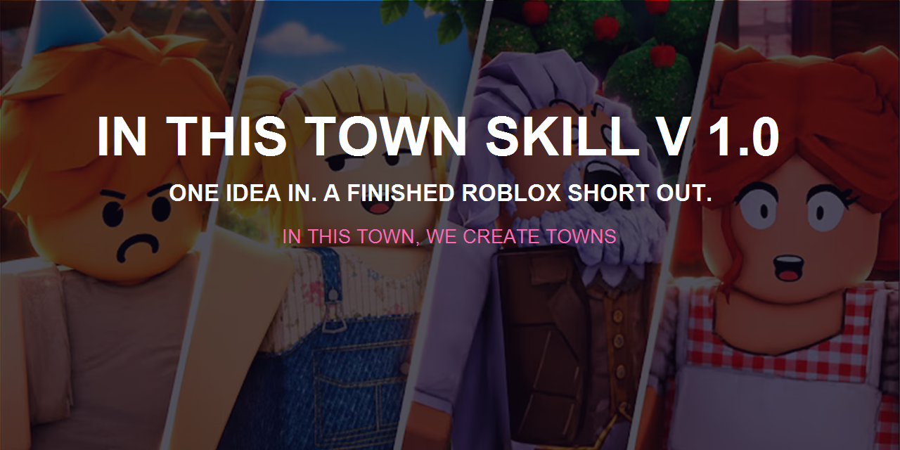
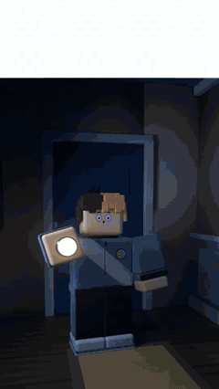
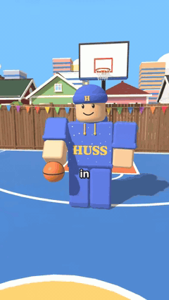
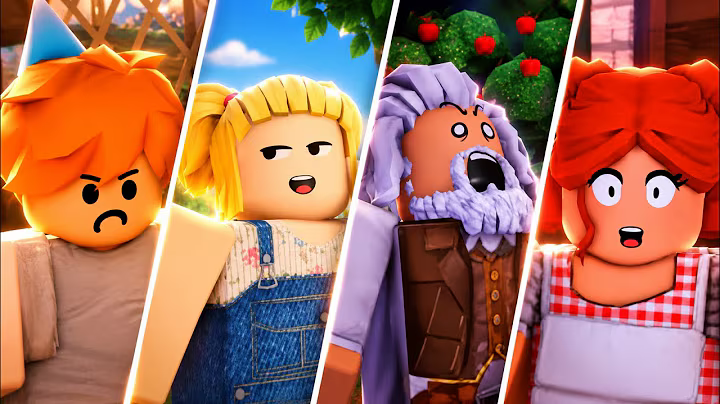
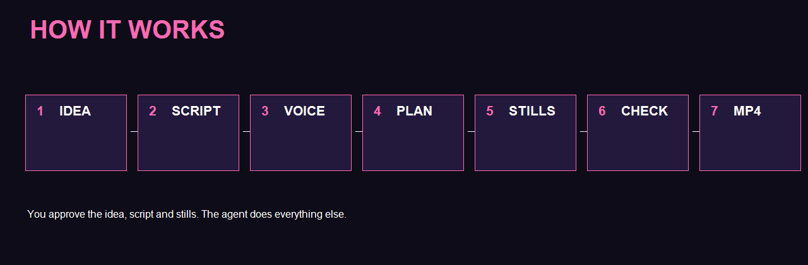

<p align="center">
  
</p>

<p align="center">

```text
  _____  _   _  ___  ____       _____   ___   _    _  _   _ 
 |_   _|| | | ||_ _|/ ___|     |_   _| / _ \\ | |  | || \\ | |
   | |  | |_| | | | \\___ \\       | |  | | | || |  | ||  \\| |
   | |  |  _  | | |  ___) |      | |  | |_| || |/\\| || |\\  |
   |_|  |_| |_||___||____/       |_|   \\___/ |__/\\__||_| \\_|
```

<span style="color:pink">IN THIS TOWN, WE CREATE TOWNS</span>

# IN THIS TOWN SKILL V 1.0

### One idea in. A finished 9:16 Roblox-style story short out.

**Give a free AI agent one sentence. It writes the story, builds the world, animates lip-syncing block characters, adds captions, voice, music and sound — then renders the MP4.**

**No Roblox Studio. No Blender. No code. No API keys. No paid plan.**

<sub>An AI Roblox story generator and text to video tool for vertical Roblox shorts — free, no-code, and built for AI agents.</sub>

[](https://github.com/hackerlolord/in-this-town-skill/releases)
[](#)
[](#install)
[](#)
[](https://github.com/hackerlolord/in-this-town-skill/stargazers)

<p align="center"><b><a href="https://github.com/hackerlolord/in-this-town-skill#-watch-it-make-a-video">▶ Watch it make a video</a></b> &nbsp;·&nbsp; <b><a href="https://github.com/hackerlolord/in-this-town-skill/raw/main/IN%20THIS%20TOWN%20SKILL%20V%201.0.zip">⬇ Download the free ZIP</a></b> &nbsp;·&nbsp; <b><a href="#install">Full setup guide</a></b></p>

**[⬇ DOWNLOAD THE SKILL — `IN THIS TOWN SKILL V 1.0.zip`](https://github.com/hackerlolord/in-this-town-skill/raw/main/IN%20THIS%20TOWN%20SKILL%20V%201.0.zip)**

</p>

---

## 🎬 WATCH IT MAKE A VIDEO

<table align="center">
  <tr>
    <td align="center"><br><sub><b>The build</b> · world, characters, captions</sub></td>
    <td align="center"><br><sub><b>The render</b> · motion, effects, final MP4</sub></td>
  </tr>
</table>

<p align="center"><sub>Both clips are from the real demo below. Nothing was hand-animated.</sub></p>

<div align="center">

<video src="assets/demo.mp4" poster="assets/result-3.png" controls width="100%"></video>

**[▶ Open the full demo video](assets/demo.mp4)** — 15.9 s · 2992 × 1440 · 60 fps

</div>

---

## 🖼 MADE WITH THE SKILL

Three real outputs. Different rules, different worlds, different characters — never the same town twice.

<table>
  <tr>
    <td width="33.3%" valign="top"><a href="assets/result-1.png"></a></td>
    <td width="33.3%" valign="top"><a href="assets/result-2.png"></a></td>
    <td width="33.3%" valign="top"><a href="assets/result-3.png"></a></td>
  </tr>
  <tr>
    <td align="center"><sub>Story world #1</sub></td>
    <td align="center"><sub>Story world #2</sub></td>
    <td align="center"><sub>Story world #3</sub></td>
  </tr>
</table>

---

## How it works



1. **You type one idea.** `make a Roblox short about a town where every laugh makes a balloon appear`
2. **The agent writes six fresh ideas.** You pick one, or paste your own story. Nothing is written without your yes.
3. **It writes the full script.** Title, rule, narrator, every line and the word count. You approve it before any voice work starts.
4. **It plans the video.** Cast, places, effects, mood and camera moves.
5. **It builds stills and checks them.** Framing, empty shots, clipping and stuck characters are caught before rendering.
6. **It adds voice and sound.** Free local Kokoro TTS, Google AI Studio, or your own WAV/MP3. Then music, timed SFX and word-by-word captions.
7. **It renders `out/video.mp4`.** Want a change? Say it in one sentence and the agent rebuilds it.

---

## What it makes

- **Block avatars with pixel faces** that lip-sync to the narration
- **Procedural worlds** — suburbs, meadows, plazas, city streets, rooms, or ~55 free themed kits
- **Life and effects** — walking NPCs, driving cars, magic, jumps, falls, crashes and camera moves
- **Viral captions** — word-by-word, in the style short-form viewers expect
- **Timed sound** — music bed, whooshes, hits, pops and reactions
- **Quality checks** before every render, plus a new seed, cast and place for every video

No Roblox Studio. No Blender. No extra skills. Everything lives in the ZIP.

---

## Story formats built in

No idea yet? The skill has five proven shapes, measured on viral shorts from 25 to 120 seconds.

| Shape | Length | Feel | Try typing |
|---|---|---|---|
| **The rule is the rescue tool** | 60–100 s | funny → heroic | *in this town, every time you say "sorry", a tiny elephant appears* |
| **The greedy one gets caught** | 90–110 s | cheeky → karmic | *a kid cheats the rule and gets counted* |
| **The town is afraid for the wrong reason** | 100–120 s | silly → reveal | *everyone thinks the thing under the bed is a monster* |
| **The newcomer breaks it** | 35–45 s | dark twist | *a new kid breaks the rule on purpose* |
| **The cliffhanger** | 25–35 s | slow dread | *the rule breaks the world, and one line cuts it off* |

Your own script is always accepted word for word — it is never rewritten without your permission.

---

## 📦 What's in the ZIP

```
IN THIS TOWN SKILL V 1.0/
├── SKILL.md              the complete agent instructions
├── script.md             the five story shapes
├── examples.md           finished example scripts
├── look.md               pacing, shots, acting, captions, sound
├── api.md                characters, worlds, kits, effects, checks
└── template/             the full working renderer
    ├── setup.mjs         one-click setup
    ├── voice.mjs         voice import + timing
    ├── render.mjs        stills, checks and final video
    ├── pf.mjs            free 3D kits and models
    ├── lib/blocky/       the blocky 3D engine
    ├── scenes/           example scenes and game layer
    ├── audio/            music, SFX planner and sound kit
    ├── fonts/            Montserrat
    ├── textures/         ground, sky and tree textures
    └── install/          Node installers for Mac/Windows/Linux
```

---

<a name="install"></a>

## ⚡ Install in 60 seconds

**Use any free AI agent you like.** Download one of these, upload the ZIP **directly** into it, and tell the agent to install and run the skill.

### 1️⃣ Download a free agent

| Agent | Direct Windows download | All platforms / notes |
|---|---|---|
| **OpenCode** | [opencode-desktop-win-x64.exe](https://opencode.ai/update/api/latest/desktop/opencode/opencode-desktop-win-x64.exe) | [All downloads](https://opencode.ai/download) · desktop, terminal, mobile |
| **Antigravity** | [Antigravity-x64.exe](https://storage.googleapis.com/antigravity-public/antigravity-hub/2.35.2-4585983447007232/windows-x64/Antigravity-x64.exe) | [Download page](https://antigravity.google/download) · IDE, CLI, extensions |
| **Kilo AI (Kilo Code)** | [VS Code](https://code.visualstudio.com/download) → Extensions → **Kilo Code** (pre-release) | [Install guide](https://kilo.ai/docs/getting-started/installing) · [VSIX releases](https://github.com/Kilo-Org/kilocode/releases/latest) |
| **Free Buff** | [Windows 64-bit installer](https://freebuff.com/api/desktop/download/windows) | [freebuff.com](https://freebuff.com/) · 100% free coding agent |
| **Deep AI Code** | [windows-x64 installer](https://deepai.org/download/deepai-code/windows-x64) | [deepai.org/chat/ai-code](https://www.deepai.org/chat/ai-code) · Mac, Windows, Linux |

### 2️⃣ Upload the ZIP — **do not extract it**

Download **[`IN THIS TOWN SKILL V 1.0.zip`](https://github.com/hackerlolord/in-this-town-skill/raw/main/IN%20THIS%20TOWN%20SKILL%20V%201.0.zip)** and drop the file straight into your agent's chat/upload box. Leave it zipped.

> ⚠️ **Do not unzip it. Do not rename it. Do not copy the files one by one.** Upload the whole ZIP exactly as downloaded.

### 3️⃣ Say this to the agent

```
Install and set up the skill in the ZIP I just uploaded.
The skill's name is IN THIS TOWN SKILL V 1.0.
Do not extract the ZIP yourself — use your skill installer.
Once it is installed, run it and make me a Roblox short.
```

### 4️⃣ Your first short

Open a new folder with your agent and type:

```
make a Roblox short about a town where every laugh makes a balloon appear
```

On first run the skill installs Node for your user if missing, then three.js, a browser and ffmpeg (~400 MB). No admin rights needed.

---

## 🛠 What it sets up for you

| | |
|---|---|
| **Node.js** | Installed for your user only if missing — no admin rights needed |
| **three.js + browser + ffmpeg** | Installed automatically on first run (~400 MB) |
| **Voice** | Free local Kokoro TTS, Google AI Studio in your browser, or your own WAV/MP3 — no key pasted into chat |
| **Music & SFX** | Supplied soundtrack, automatic sound-effects plan, timed whooshes, hits and pops |
| **Quality checks** | Framing, empty shots, clipping, stuck characters and repeat-place checks before the render |
| **Preview** | Optional live browser preview with sound |

**Works on** Windows, macOS and Linux. Renderers are slower on old GPUs — keep the first video short. If Windows Firewall blocks the local renderer, allow Node.js through and run the same command again.

---

## 🔮 V2.0 — ALREADY IN THE WORKS

<div align="center">


</div>

**The next chapter is bigger than a short.**

- **Free cloud GPU support** — if your GPU is slow, old or missing, render in the cloud instead. No upgrade needed.
- **Long-form Roblox story creation** — full-length stories, not just 30–60 second shorts: more beats, more scenes, more characters, one continuous world.

⭐ **[Star the repo](https://github.com/hackerlolord/in-this-town-skill/stargazers)** so you don't miss V2.0.

---

## ❓ FAQ

<details>
<summary><b>Do I need Roblox Studio?</b></summary>

No. The videos are drawn in code by the bundled three.js engine. Nothing is installed into Roblox and no game assets are uploaded.
</details>

<details>
<summary><b>Do I need to know how to code?</b></summary>

No. You pick an idea, a length, a voice and approve the script/stills. The agent writes and runs every command.
</details>

<details>
<summary><b>Is it really free?</b></summary>

The skill ZIP is free. The three voice routes are free: local Kokoro TTS, Google AI Studio, or audio you already own. The agents listed above all have free tiers.
</details>

<details>
<summary><b>Why should I keep the ZIP zipped?</b></summary>

The agent's skill installer reads the archive structure. Uploading the ZIP directly is the documented install path; manually extracting files can break the folder name and the installer's checks.
</details>

<details>
<summary><b>Can I use my own script?</b></summary>

Yes — choose "your own story" at step 2 and paste your rule, idea or script. It gets voiced word for word; no changes are made without your yes.
</details>

<details>
<summary><b>Can I make more than one video?</b></summary>

Yes. Finished videos are archived automatically and the next one gets a new cast, place, theme and seed. The skill refuses to quietly remake the same town.
</details>

---

## 🤝 Credits

Created by **MyLisaAi** · [youtube.com/@mylisaai](https://youtube.com/@mylisaai?si=u9jj41ZBSL_o_hi7)

If this skill made your day, subscribe to the channel — that's what keeps these free skills coming.

---

## 📄 Licence

MIT — use it, edit it, make money with it. See [`LICENSE`](LICENSE).

<p align="center"><sub>IN THIS TOWN SKILL V 1.0 · <span style="color:pink">IN THIS TOWN, WE CREATE TOWNS</span></sub></p>
